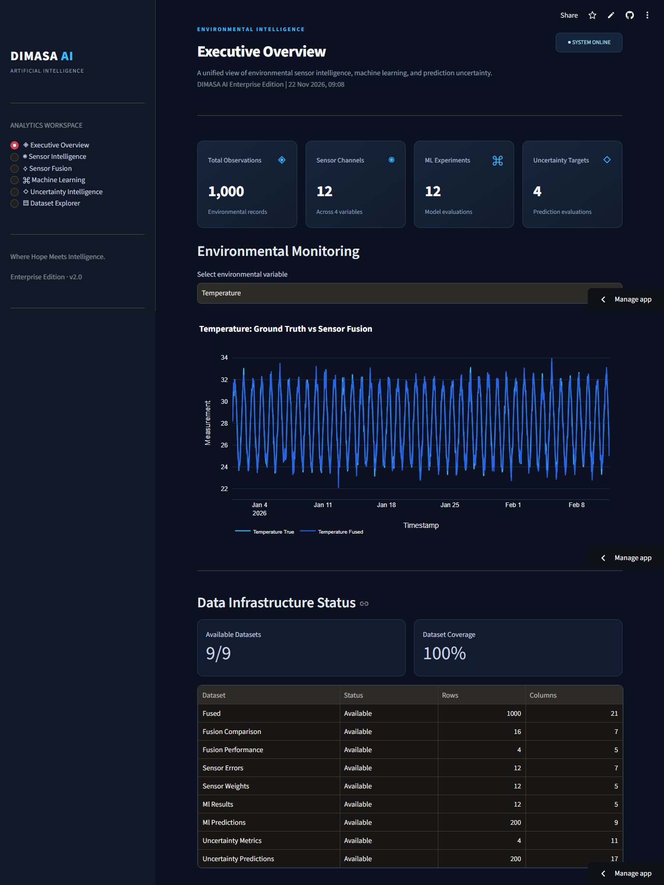

# DIMASA AI

### Artificial Intelligence & Innovation

**Where Hope Meets Intelligence.**

*Inspired by Dreams. Built for the Future.*

---

## 🚀 Live Demo

**Explore DIMASA AI — Environmental Sensor Intelligence**

Experience the interactive dashboard featuring multi-sensor data fusion, machine learning predictions, and uncertainty quantification.

[](https://dimasa-ai.streamlit.app)

**Live Application:** https://dimasa-ai.streamlit.app

---

---

### Dashboard Preview



*Executive Overview — Environmental Sensor Intelligence*

## About DIMASA AI

DIMASA AI is an independent Artificial Intelligence and innovation initiative focused on exploring, researching, and developing intelligent technologies to address real-world challenges.

The initiative emphasizes Artificial Intelligence, Machine Learning, Deep Learning, data intelligence, and responsible technology development.

DIMASA AI aims to transform ideas and experimentation into practical, meaningful, and human-centered technological solutions.

## Vision

To become an artificial intelligence innovation initiative that develops intelligent, adaptive, and beneficial technologies to help people solve real-world problems and build a better future.

## Mission

1. **Develop Intelligent Technology** — Build innovative and adaptive AI solutions relevant to real-world needs.
2. **Human-Centered AI** — Create technologies that support productivity, creativity, decision-making, and problem-solving.
3. **Responsible AI Innovation** — Promote security, transparency, fairness, and responsibility in technology development.
4. **Continuous Research & Development** — Explore Machine Learning, Deep Learning, Generative AI, and emerging computing technologies.
5. **Create Meaningful Impact** — Develop innovations that provide practical value and positive contributions to society.

## Core Values

| Value | Meaning |
|---|---|
| Innovation | Exploring new possibilities through technology. |
| Intelligence | Applying intelligent thinking and critical reasoning. |
| Integrity | Developing technology responsibly and transparently. |
| Persistence | Learning, experimenting, and continuously improving. |
| Purpose | Building technology with meaningful objectives. |

---

# Featured Project

## Multi-Sensor Data Fusion & Uncertainty-Aware Prediction System

**Environmental Sensor Intelligence**

An experimental AI/ML system designed to investigate how incomplete and noisy environmental sensor observations can be combined to produce more reliable measurements and predictive insights.

The project integrates multi-sensor data fusion, machine learning, and uncertainty quantification into an end-to-end environmental intelligence workflow.

### Project Objectives

- Simulate environmental sensor observations with measurement noise and missing readings.
- Analyze sensor accuracy, measurement errors, and reliability.
- Implement inverse-variance weighted sensor fusion.
- Develop Machine Learning models for environmental prediction.
- Quantify predictive uncertainty through Split Conformal Prediction.
- Evaluate model performance using appropriate statistical metrics.
- Visualize analytical results through an interactive dashboard.

### Environmental Variables

| Variable | Unit | Sensor Channels |
|---|---|---:|
| Temperature | °C | 3 |
| Humidity | % | 3 |
| Atmospheric Pressure | hPa | 3 |
| PM2.5 | µg/m³ | 3 |
| **Total** | | **12** |

### Dataset Overview

The project uses a simulated environmental dataset containing:

- 1,000 chronological observations.
- 17 original data columns.
- 4 ground-truth environmental variables.
- 12 simulated sensor channels.
- Noisy sensor readings and intentionally introduced missing values.

**Important:** This is a synthetic research and experimentation dataset. The results demonstrate the implemented methodology under simulated conditions and should not be interpreted as validated real-world sensor performance.

---

## System Architecture & Methodology

### 1. Synthetic Data Generation

Generate simulated environmental observations with ground-truth measurements, sensor noise, and missing readings.

### 2. Sensor Error Analysis

Evaluate individual sensor performance using:

- Mean Absolute Error (MAE)
- Root Mean Squared Error (RMSE)
- Measurement Bias
- Valid Sample Count

### 3. Multi-Sensor Data Fusion

Combine sensor readings measuring the same physical variable using inverse-variance weighting.

The fusion process accounts for missing observations by renormalizing the weights of available sensors.

Sensor reliability weights are estimated from calibration data and applied to subsequent observations.

### 4. Machine Learning

Develop and compare three regression algorithms:

- Linear Regression
- Random Forest Regressor
- Gradient Boosting Regressor

The system predicts four environmental variables using information from other fused environmental variables and cyclical time features.

Each target excludes its own fused measurement to avoid direct target leakage.

Model selection uses validation MAE, followed by final evaluation on an independent chronological test set.

### 5. Uncertainty Quantification

Apply Split Conformal Prediction to generate prediction intervals around model predictions.

The uncertainty pipeline uses:

| Dataset | Allocation | Samples |
|---|---:|---:|
| Training | 60% | 600 |
| Calibration | 20% | 200 |
| Testing | 20% | 200 |

Evaluation metrics include:

- Conformal Quantile
- Empirical Coverage
- Mean Prediction Interval Width
- MAE
- RMSE

The nominal coverage target is 90%.

**Methodological limitation:** Classical split conformal coverage guarantees rely on exchangeability. Since this project uses chronological observations, temporal dependence may affect the coverage guarantee. Reported coverage is therefore interpreted empirically on the held-out test set.

---

## Experimental Results

### Sensor Fusion Performance

Weighted sensor fusion was compared against individual sensor measurements using common valid test observations.

| Variable | Best Individual MAE | Fusion MAE | Improvement |
|---|---:|---:|---:|
| Temperature | 0.3977 | 0.3360 | 15.51% |
| Humidity | 0.7794 | 0.7156 | 8.18% |
| Pressure | 0.2678 | 0.2221 | 17.06% |
| PM2.5 | 2.1764 | 1.9300 | 11.32% |

Weighted Fusion achieved a lower MAE than the best individual sensor across all four variables in the reported comparison.

### Machine Learning Test Performance

The selected models were evaluated on the final 200 chronological test observations.

| Target | Selected Model | Test MAE | Test RMSE | Test R² |
|---|---|---:|---:|---:|
| Temperature | Linear Regression | 0.4044 | 0.5315 | 0.9657 |
| Humidity | Linear Regression | 1.2175 | 1.4994 | 0.9705 |
| Pressure | Random Forest | 0.3668 | 0.4629 | 0.9534 |
| PM2.5 | Linear Regression | 2.3813 | 3.0076 | 0.8495 |

### Uncertainty Quantification Results

Nominal coverage target: 90%.

| Target | Empirical Test Coverage | Mean Interval Width |
|---|---:|---:|
| Temperature | 92.00% | 1.7672 |
| Humidity | 88.50% | 4.9595 |
| Pressure | 87.50% | 1.5177 |
| PM2.5 | 91.00% | 9.9663 |

These results represent empirical coverage on the simulated test dataset, not guaranteed future coverage.

---

## Interactive Dashboard

DIMASA AI includes a Streamlit-based analytics dashboard with six main pages.

| Dashboard Page | Description |
|---|---|
| Executive Overview | Overall environmental intelligence and system status. |
| Sensor Intelligence | Sensor accuracy, measurement errors, and data availability. |
| Sensor Fusion | Fusion performance, reliability weights, and comparisons. |
| Machine Learning | Validation model comparison and final test evaluation. |
| Uncertainty Intelligence | Prediction intervals and empirical coverage analysis. |
| Dataset Explorer | Dataset inspection, filtering, data quality, and CSV export. |

---

## Technology Stack

### Programming Language
- Python 3.12

### Data Processing & Analysis
- NumPy
- Pandas

### Machine Learning
- Scikit-learn
- Joblib

### Data Visualization
- Matplotlib
- Plotly

### Interactive Dashboard
- Streamlit

### Testing
- Pytest

### Development Environment
- Visual Studio Code
- PowerShell
- Git & GitHub

---

## Project Structure

```text
dimasa-ai/
│
├── app/
│   ├── components/
│   ├── utils/
│   ├── views/
│   └── dashboard.py
│
├── data/
│   ├── simulated/
│   └── processed/
│       └── visualizations/
│
├── models/
│
├── notebooks/
│
├── src/
│   ├── data/
│   ├── fusion/
│   └── models/
│
├── tests/
│
├── requirements.txt
└── README.md
```

---

## Getting Started

### 1. Clone the Repository

```bash
git clone https://github.com/DimasApril24/dimasa-ai.git
cd dimasa-ai
```

### 2. Create a Virtual Environment

```bash
python -m venv .venv
```

Activate on Windows PowerShell:

```powershell
.venv\Scripts\Activate.ps1
```

### 3. Install Dependencies

```bash
pip install -r requirements.txt
```

### 4. Run the Dashboard

From the project root:

```powershell
$env:PYTHONPATH = (Get-Location).Path
python -m streamlit run app/dashboard.py
```

### 5. Run Automated Tests

```bash
python -m pytest tests/ -v
```

---

## Testing & Quality Assurance

The current automated test suite contains 28 passing tests.

| Test Module | Tests | Result |
|---|---:|---|
| Data Quality | 10 | Passed |
| Sensor Fusion | 18 | Passed |
| **Total** | **28** | **Passed** |

Testing covers dataset integrity, chronological ordering, sensor fusion calculations, reliability weights, missing readings, and metric calculations.

---

## Development Roadmap

| Phase | Focus | Status |
|---|---|---|
| 0 | Environment Setup | Completed |
| 1 | Synthetic Data Generation & Exploration | Completed |
| 2 | Sensor Error Analysis & Data Quality | Completed |
| 3 | Multi-Sensor Data Fusion | Completed |
| 4 | Machine Learning Models | Completed |
| 5 | Uncertainty Quantification | Completed |
| 6 | Interactive Dashboard Development | Implemented |
| 7 | Automated Testing | Completed |
| 8 | Final QA & Documentation | In Progress |
| 9 | GitHub Publication & Portfolio Presentation | Planned |

---

## Project Philosophy

DIMASA represents the combination of personal identity, inspiration, and hope.

The name also resonates with the Indonesian phrase *"di masa depan"*, symbolizing a forward-looking vision of technology, innovation, and artificial intelligence.

It reflects a belief that technology should not only be intelligent but also meaningful, responsible, and beneficial.

**DIMASA AI — Inspired by Dreams. Built for the Future.**

---

*An independent AI innovation initiative.*  
